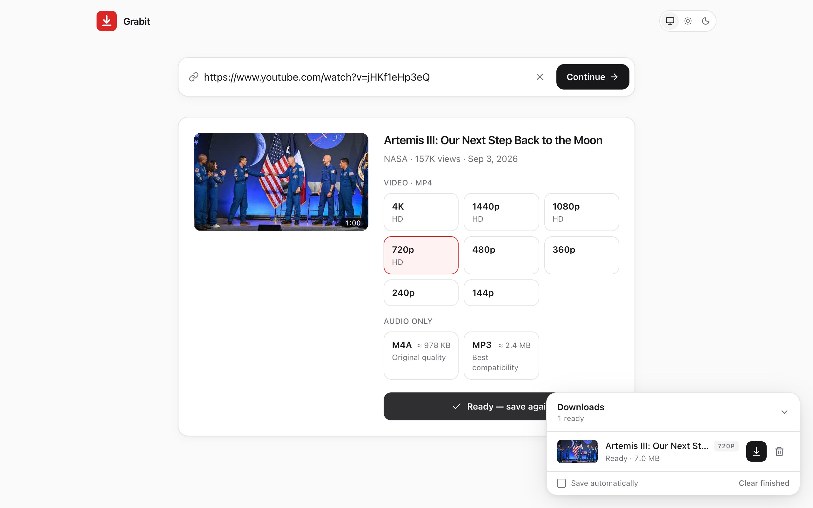
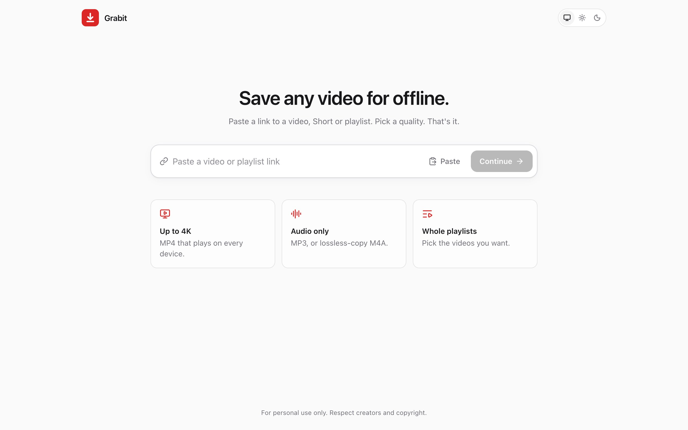
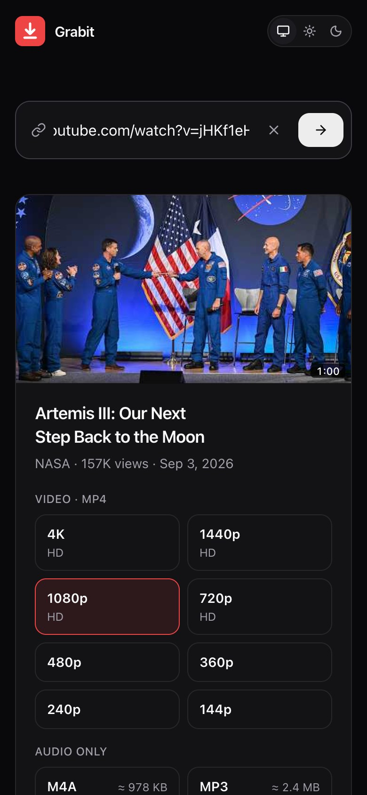
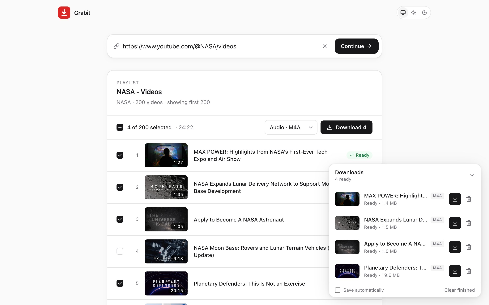
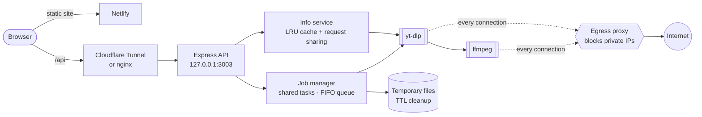

<div align="center">


# Grabit

**Download videos, audio and playlists in any quality: a clean web UI for yt-dlp.**

Paste a link, pick a quality, done. Self-hosted, fast, and built to serve many people at once.

[](LICENSE)
[](https://nodejs.org)
[](https://react.dev)
[](https://expressjs.com)
[](https://tailwindcss.com)
[](https://github.com/yt-dlp/yt-dlp)

[Features](#features) · [Screenshots](#screenshots) · [Quick start](#quick-start) · [How it works](#how-it-works) · [Deploy](#deploy) · [Configuration](#configuration) · [API](#api)

<br />

<picture>
  <source media="(prefers-color-scheme: dark)" srcset="docs/screenshots/video-dark.jpg" />
  
</picture>

</div>

## Features

| Feature | What you get |
|---|---|
| 🎬 **Any quality** | 144p up to 4K, delivered as MP4 (H.264 + AAC where available) that plays on every device |
| 🎧 **Audio only** | MP3 for compatibility, or M4A copied straight from the source without re-encoding |
| 🌐 **1,000+ sites** | YouTube, TikTok, X, Twitch, SoundCloud, Dailymotion, Bilibili, archive.org and every other site yt-dlp supports, plus direct media links |
| 📚 **Playlists and channels** | Select the videos you want, choose one quality, and download them as a batch |
| 📥 **Downloads panel** | Live progress, queue position, speed and time left, with cancel, retry and save; survives a page reload |
| ⚡ **Paste and go** | Pasting a link fetches it immediately, and each format shows its estimated file size |
| 🌗 **Light and dark** | Follows your system theme or lets you choose; works on mobile; no trackers or external fonts |
| 🧱 **Built for concurrency** | Shared caches and shared downloads, bounded queues and per-user limits |
| 🔒 **Secure by default** | Network-level SSRF protection, no shell execution, sanitised errors, rate limiting, sandboxed deployment |

## Screenshots

<table>
  <tr>
    <td width="66%"></td>
    <td rowspan="2" width="34%"></td>
  </tr>
  <tr>
    <td></td>
  </tr>
</table>

<sub>Screenshots show public-domain NASA videos.</sub>

## Quick start

**Requirements:** Node.js 22.12+, [yt-dlp](https://github.com/yt-dlp/yt-dlp), [ffmpeg](https://ffmpeg.org), and [Deno](https://deno.com). yt-dlp needs a JavaScript runtime to download from YouTube.

```bash
# macOS (on Linux, see deploy/update-ytdlp.sh for a checksum-verified yt-dlp install)
brew install yt-dlp ffmpeg deno

git clone https://github.com/stanleyowen/grabit.git && cd grabit

# Terminal 1: API on http://127.0.0.1:3003
cd server && npm install && npm run dev

# Terminal 2, from the repo root: web app on http://localhost:5173 (proxies /api to the API)
cd client && npm install && npm run dev
```

To point the web app at a different API, set `VITE_API_PROXY_TARGET` in `client/.env`; it defaults to `http://localhost:3003`.

**Tests** run fully offline against a fake yt-dlp:

```bash
cd server && npm test
node --test --test-name-pattern="job lifecycle" test/api.test.js   # run a single test
```

## How it works



The API never downloads the same thing twice at the same time. Each `(video, quality)` pair becomes one **task**, and each person asking for it gets their own **ticket**. They all share the same yt-dlp process and the same finished file, which is kept for 20 minutes.

| Technique | Why it matters |
|---|---|
| Metadata cache (15 min) and in-flight request sharing | 50 people pasting the same link at once trigger 1 yt-dlp call; cached lookups return in milliseconds |
| Shared download tasks | Popular videos are downloaded once, not once per user |
| One process per download | Previously each download spawned yt-dlp twice |
| Bounded concurrency and queues | When busy, the server replies with a clean `503` and `Retry-After` instead of falling over |
| Batched, adaptive polling | The UI checks all active downloads in one request and slows down when idle or in a background tab |
| Codec choice | Prefers H.264 + AAC for compatibility; M4A audio needs no CPU because it isn't re-encoded |

<details>
<summary><b>Load test results</b> (laptop, 8 cores)</summary>

| Scenario | Result |
|---|---|
| 200 concurrent clients, cached `/api/info` | ~11,500 req/s, p50 13 ms |
| 200 concurrent clients, status polling | ~16,300 req/s, p99 22 ms |
| 50 simultaneous cold lookups of one video | 1 yt-dlp process |
| 30 users downloading the same video | 1 yt-dlp process |

</details>

### Security

- **No shell, ever.** Arguments are passed as an array with a `--` terminator, `--ignore-config` is always set, and quality values come from a strict whitelist.
- **SSRF protection at the network level.** Checking the pasted URL isn't enough: pages redirect, embed players and point at manifests. So every connection yt-dlp and ffmpeg make goes through a built-in egress proxy. It resolves DNS itself, refuses private, loopback, link-local, LAN and cloud-metadata addresses (including IPv6 and IPv4-mapped forms), allows only ports 80/443, and connects to the exact IP it vetted, which defeats DNS rebinding. The pasted URL is also checked up front, and `ALLOWED_HOSTS` can restrict sites further.
- **Safe media handling.** Only formats yt-dlp downloads itself are used (no RTMP/RTSP/MMS handed to external tools), HLS is fetched natively rather than by ffmpeg, and ffmpeg may only open plain media containers when merging or converting.
- **Nothing leaks.** yt-dlp output and server paths are mapped to friendly messages, and child processes get a minimal environment.
- **Abuse limits.** Per-IP token-bucket rate limits, a cap on active downloads per user, an 8 KB request body limit, a strict CORS allow-list, CSP and HSTS.
- **Resource safety.** Hard timeouts with process-group kills (ffmpeg included), a free-disk-space guard, a maximum file size, TTL cleanup, and removal of orphaned files on boot.
- **Supply chain.** Minimal dependencies (the server depends only on `express`). yt-dlp and Deno are verified against their SHA-256 checksums and updated daily.

## Deploy

### PM2 behind a Cloudflare Tunnel (no sudo)

```bash
deploy/deploy-pm2.sh user@your-server
```

The script:

1. runs the test suite locally;
2. installs or updates yt-dlp and Deno in `~/.local/opt/video-downloader/bin`, verifying their checksums;
3. starts the new release under PM2 on a spare port with the **exact production config** and smoke-tests it;
4. swaps it in, health-checks it, and **rolls back automatically** if anything fails;
5. adds a daily cron job that updates yt-dlp.

The app listens on `127.0.0.1:3003` only. Point your tunnel at it, and Grabit reads the real client IP from `CF-Connecting-IP`, which it only trusts from loopback.

### Docker behind a Cloudflare Tunnel

```bash
cd server && docker compose up -d --build
```

`server/compose.yaml` runs the API as a non-root user with a read-only filesystem, no capabilities and memory/CPU/PID limits, published on `127.0.0.1:3003` only. yt-dlp and Deno are mounted read-only from `~/.local/opt/video-downloader/bin` (install them with `deploy/deploy-pm2.sh` or `deploy/update-ytdlp.sh`), so the daily yt-dlp update keeps working without rebuilding the image. Settings come from `~/.config/video-downloader/env` and `server/.env`, as with PM2. Because the tunnel reaches the container through the Docker bridge rather than loopback, the compose file trusts only the bridge gateway and the real client IP comes from `X-Forwarded-For`.

### systemd and nginx (root)

```bash
DOMAIN=dl.example.com deploy/deploy.sh user@your-server --bootstrap   # first time
deploy/deploy.sh user@your-server                                     # updates
```

This installs Node, ffmpeg, Deno and yt-dlp, a sandboxed systemd unit (dedicated user, read-only code, no capabilities, syscall filter, memory limits), and an nginx site that adds TLS and rate limiting and streams files with `X-Accel-Redirect`.

### Frontend (Netlify)

Use build command `npm run build` with base directory `client` and publish directory `client/dist`. The build generates `_redirects` and `_headers` (CSP, HSTS, immutable asset caching) from your environment variables:

| Variable | Purpose |
|---|---|
| `VITE_API_BASE` | Call the API directly, e.g. `https://api.example.com/api`. Recommended, because rate limits then see real client IPs. Requires `CORS_ORIGINS` on the server. |
| `VITE_DOWNLOAD_BASE` | Fetch files straight from the API host instead of through the Netlify proxy. Needs no CORS. |
| `VITE_API_PROXY_TARGET` | Target of the Netlify `/api/*` proxy, used when `VITE_API_BASE` isn't set. |

## Configuration

The API is configured through environment variables. Every option is documented in [`server/.env.example`](server/.env.example); these are the most common:

| Variable | Default | |
|---|---|---|
| `HOST` / `PORT` | `127.0.0.1` / `3003` | Keep it on loopback behind a proxy |
| `CLIENT_IP_HEADER` | — | e.g. `cf-connecting-ip`; trusted only from loopback |
| `CORS_ORIGINS` | — | Comma-separated origins allowed to call the API |
| `MAX_CONCURRENT_DOWNLOADS` | CPU cores (2–8) | yt-dlp downloads running in parallel |
| `MAX_ACTIVE_JOBS_PER_CLIENT` | `6` | Queued or running downloads allowed per user |
| `FILE_TTL_MS` | `1200000` | How long finished files are kept and shared |
| `MIN_FREE_DISK_MB` / `MAX_FILESIZE` | `2048` / `4G` | Disk safety limits |
| `ALLOWED_HOSTS` | any | Restrict to sites by suffix, e.g. `youtube.com,vimeo.com` |
| `ENABLE_GENERIC_EXTRACTOR` | `true` | Direct media links and embedded players; only active with the egress proxy |
| `EGRESS_PROXY` / `EGRESS_ALLOWED_PORTS` | `true` / `80,443` | Network-level SSRF protection for yt-dlp and ffmpeg |
| `DNS_SERVERS` | system | Resolver for SSRF checks and the egress proxy, e.g. `1.1.1.1,9.9.9.9` to bypass a local DNS filter |
| `YTDLP_COOKIES_FILE` | — | cookies.txt for when a site demands sign-in |

## API

| Method | Endpoint | Description |
|---|---|---|
| `POST` | `/api/info` | `{ url }` → video `{ type: "video", formats[] }` or playlist `{ type: "playlist", entries[] }` |
| `POST` | `/api/jobs` | `{ url, quality }` → a job ticket. `quality` is `2160p`…`144p`, `mp3` or `m4a` |
| `GET` | `/api/jobs?ids=a,b,…` | Batch status for up to 50 jobs |
| `GET` | `/api/jobs/:id` | Status, progress, speed, ETA and queue position |
| `DELETE` | `/api/jobs/:id` | Cancel a job; the download stops once no one else needs it |
| `GET` | `/api/jobs/:id/file` | The finished file (supports range requests) |
| `GET` | `/api/health` | Queue and cache statistics |

Errors use the shape `{ "error": { "code", "message" } }`. A `Retry-After` header is set on `429` and `503` responses.

## Project structure

```
client/   React 19 + Vite 8 + Tailwind 4 web app
server/   Express 5 API: src/lib (yt-dlp runner, URL safety, limits), src/services (info, jobs)
deploy/   PM2, systemd, nginx and yt-dlp update scripts
```

## License

[Apache 2.0](LICENSE)

> [!IMPORTANT]
> Grabit is for personal use. Respect creators, the Terms of Service of the sites you download from, and copyright law.
